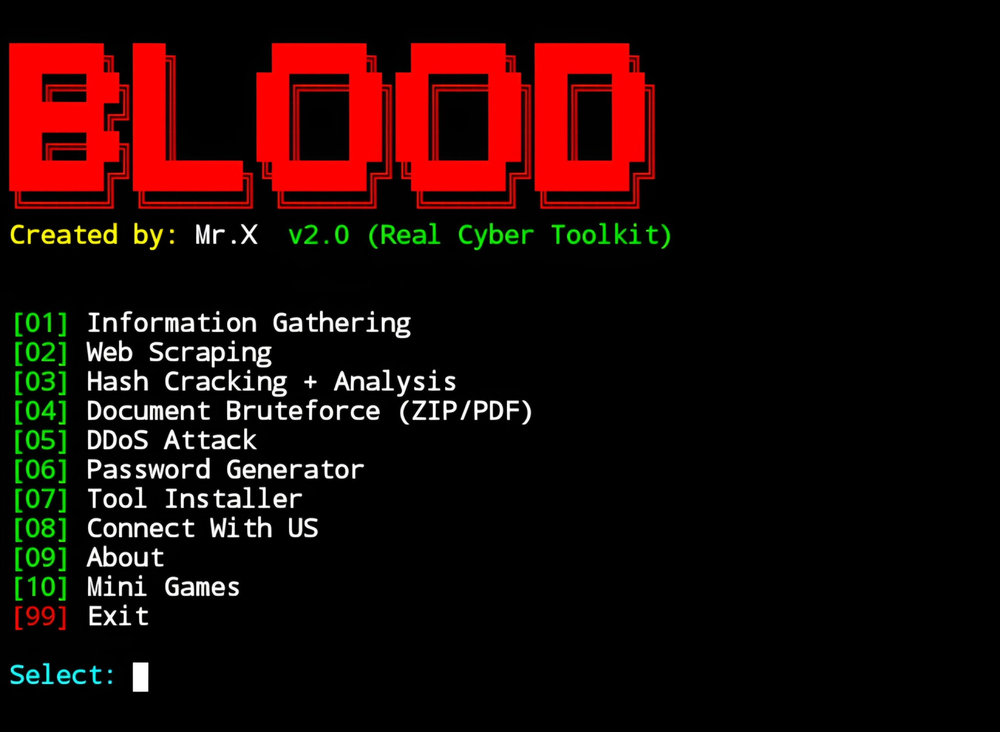

# Blood


## introduction
Blood is a tool used by cybersecurity professionals with many useful tools in it for cybersecurity and there are also mini games that can be used when bored.

## Instalations
```
$ pkg update -y && pkg upgrade -y
$ pkg install git -y
$ git clone https://github.com/Whomrx666/Blood.git 
$ cd Blood
$ python install.py

```
## Run
```
$ python Blood.py
```

## Features

+ ### Information Gathering
```
[01] Track by IP Address
[02] Analyze Email Address
[03] Analyze Phone Number
[04] Scan Username (50+ Platforms)
[05] Domain Intelligence
[06] Track IP by Domain
```

+ ### Web Scraping
```
[01] Fetch Title & Text
[02] Show Full HTML
```

+ ### Hash Cracking + Analysis
```
[01] Crack & Analyze Hash (Online via Hashes.com)
```

+ ### Document Bruteforce (ZIP/PDF)
```
[01] Bruteforce ZIP
[02] Bruteforce PDF
```

+ ### DDoS Attack
```
[01] Layer 7 – HTTP Flood (Domain/URL)
[02] Layer 4 – UDP Flood (IP + Port) [ROOT ONLY]
```

+ ### Tool Installer
```
[01] 007-TheBond ====> 📱 WhatsApp & SMS bomber
[02] AllHackingTools ====> 🧰 All-in-one hacking toolkit
[03] Asura ====> 🕵️ Advanced OSINT & info gathering
[04] B4Bomber ====> 📨 SMS bomber (Indonesia-focused)
[05] BannerX ====> 🎨 Custom ASCII banner generator
[06] Beast_Bomber ====> 💣 Multi-service SMS/email bomber
[07] BruteX ====> 🔓 SSH & service brute-force scanner
[08] CAM-DUMPER ====> 📸 Camera phishing toolkit
[09] CloneWeb ====> 🌐 Clone websites for phishing
[10] Cracker-Tool ====> 🔑 Password & hash cracker suite
[11] DarkFly ====> 🕷️ Ethical hacking & pentesting suite
[12] DefGen ====> 🛡️ Payload & shellcode generator
[13] DirAttack ====> 📁 Directory & file brute-forcer
[14] Gmail-Hack ====> 📧 Gmail account checker/phisher
[15] Hacked ====> 💀 Custom hacking-themed scripts
[16] Hammer ====> 🌪️ DDoS stress testing tool
[17] InstaReport ====> 📸 Instagram report spammer
[18] IP_Rover ====> 🌍 IP & location tracker
[19] kalimux ====> 💉 Kali Linux-style Termux theme
[20] LordPhish ====> 🎭 Advanced phishing page generator
[21] Lucifer ====> 🔥 Multi-purpose phishing & recon tool
[22] maskphish ====> 🔗 URL masking for phishing
[23] Mega-File-Stealer ====> 📁 Steal files via phishing link
[24] Metasploit ====> 💥 Full Metasploit Framework for Termux
[25] mrphish ====> 🎣 Camera & location phishing
[26] MyServer ====> 🖥️ Localhost server & tunneling tool
[27] nikto ====> 🕵️ Web server vulnerability scanner
[28] nmap ====> 🌐 Network mapper & port scanner
[29] onex ====> 🧪 All-in-one penetration toolkit
[30] Osintgram ====> 📸 Instagram OSINT tool
[31] Pureblood ====> 🧬 Forensics, recon & exploitation suite
[32] Pycompile ====> 🔒 Python script obfuscator & compiler
[33] RED_HAWK ====> 🔍 Web recon & vulnerability scanner
[34] saycheese ====> 📸 Grab front camera photo via link
[35] ScannerX ====> 🔎 Network & service scanner
[36] seeker ====> 📍 Accurate geolocation via phishing
[37] seeu ====> 👁️ Real-time location & device info grabber
[38] slowloris ====> 🐌 Low-bandwidth DoS attack tool
[39] SocialBox-Termux ====> 🧨 Social media brute-force toolkit
[40] SploitX ====> 💣 Exploit & payload generator
[41] sqlmap ====> 🧪 Automatic SQL injection & DB takeover
[42] TBomb ====> 📞 Powerful SMS/Call bomber
[43] termux-key ====> ⌨️ Add extra keys to Termux keyboard
[44] tstyle ====> 🎨 Customize Termux UI/theme
[45] userfinder ====> 🔍 Find usernames across platforms
[46] websploit ====> 🧰 Web-based exploitation framework
[47] zphisher ====> 🎭 Automated phishing toolkit (80+ templates)
```

+ ### Mini Games
```
[01] 🐍 sssnake
[02] 🔢 Number Guessing
[03] ❌ Tic-Tac-Toe
[04] 💀 Hangman
[05] 🧮 2048
[06] 💣 Minesweeper
[07] ✊ Rock Paper Scissors
[08] 🧩 Sudoku 4×4
[09] ♠ Blackjack
[10] 🧱 Tetris Mini
[11] 🧠 Memory Match
[12] 🔢 15-Puzzle
[13] ⚔️  RPG Mini
[14] ♟️  Chess vs AI
```

## facing Issue ?

+ If you're facing any kind of issue or error then you can tell me on Whatsapp, My profile URL is given down below

+ [WhatsApp](https://wa.me/6285926601133)

## Default Password for bruteforce
```
pass.txt
```

## Observation
This is a tool for education only, I am not responsible for any misuse
### Original Author
<a href="https://github.com/Whomrx666"></a>

### <<< If you copy , Then Give me The Credits >>>

## CONNECT WITH ME :

[](https://whomrxhackers.blogspot.com/)
[](https://twitter.com/whomrx666)
[](https://wa.me/6285926601133?text=Halo%2C%20Mr.X)
[](https://www.facebook.com/whomrx.666)
[](https://t.me/Whomr_X)
[](mailto:whomrx666@gmail.com)
[](https://www.tiktok.com/@whomr.x)

**If you want to donate, click on the button**
<a href="https://saweria.co/whomrx"></a>

---

<p align="left">
  
</p>

---

# Thank you for using my repo